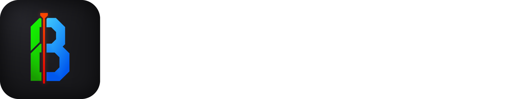
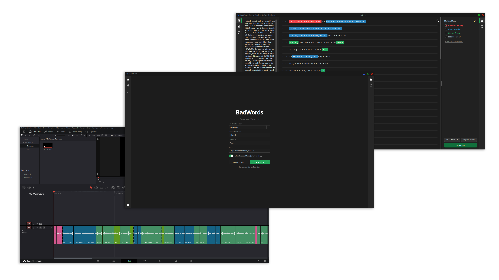
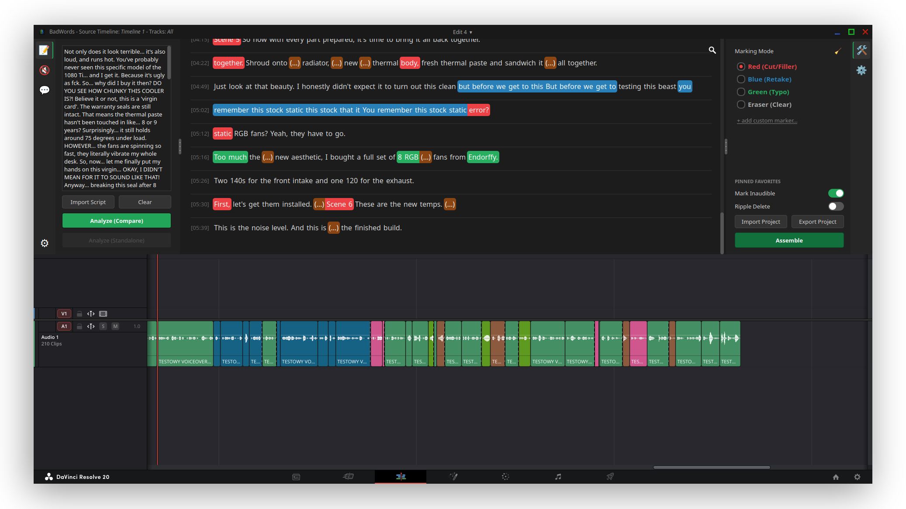
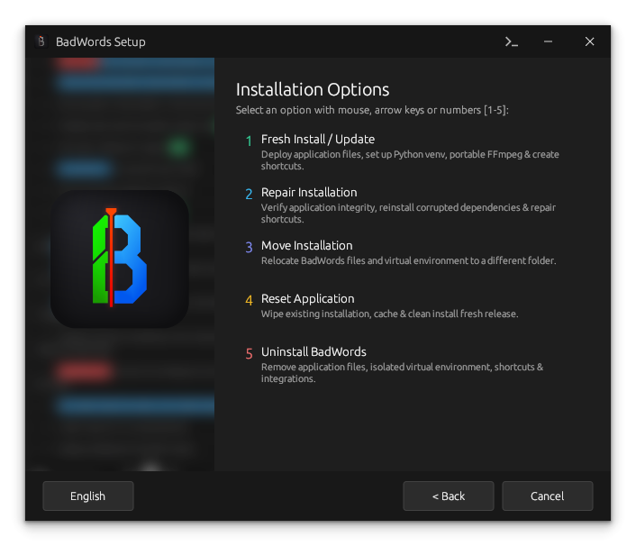
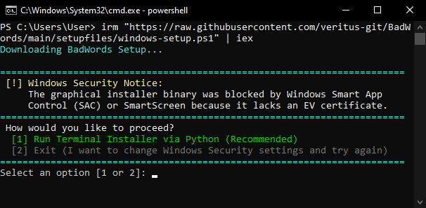
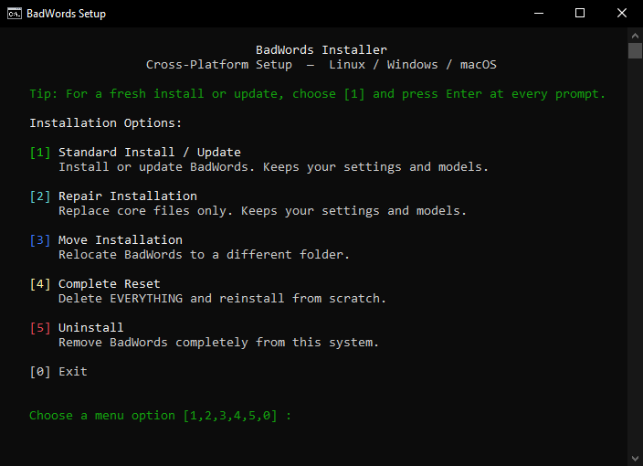

# &nbsp;
**Cleaner Timelines, Faster. The AI Rough Cut Studio — Built for DaVinci Resolve & Beyond.**

<br>

<p align="center">
  
</p>

<br>

<p align="center">
  <a href="#windows"></a>
  &nbsp;&nbsp;&nbsp;&nbsp;
  <a href="#macos"></a>
  &nbsp;&nbsp;&nbsp;&nbsp;
  <a href="#linux-any-distro"></a>
</p>

<p align="center">
  <a href="#installation"></a>
  &nbsp;&nbsp;&nbsp;&nbsp;
  <a href="docs/USER_GUIDE.md"></a>
  &nbsp;&nbsp;&nbsp;&nbsp;
  <a href="https://buymeacoffee.com/badwords" target="_blank"></a>
</p>

<br>

> [!NOTE]
> ### BadWords v4 — Work in Progress & Early Access
> **BadWords v4 is still actively in development** and doesn't have every feature I planned yet.
> 
> I'm releasing it now because version 3.2.4 broke on fresh installs due to an upstream PyAV update, and months of improvements and new tools were sitting in dev. Instead of keeping it unreleased forever, I wanted to get a working version into your hands.
> 
> Since it's an active development build, **you might hit bugs, rough edges, or things that feel clunky or unintuitive**. If you run into anything at all, please let me know — open an [Issue on GitHub](https://github.com/veritus-git/BadWords/issues) or write to me at **[badwords.git@gmail.com](mailto:badwords.git@gmail.com)**. I'm an 18-year-old solo developer, so feedback from real editing sessions is the only way I can find edge-case bugs and keep improving the app.

<br>

##  What is it?

**BadWords** is an all-in-one **AI Rough Cut Studio** built for video creators, editors, and anyone dealing with dialogue-heavy footage (podcasts, talking heads, interviews, gameplays). While deeply integrated with DaVinci Resolve, BadWords is no longer just a plugin — it now operates as a complete, standalone rough-cutting workstation capable of exporting cut timelines to **any NLE** (DaVinci Resolve, Adobe Premiere Pro, Apple Final Cut Pro, and more).

Instead of scrubbing through hours of audio on a timeline to find silences, retakes, and filler words, BadWords transforms your rough-cutting workflow into an easy, intuitive text-editing experience.

It uses local AI (Faster-Whisper & Apple MLX) to give you an ultra-precise verbatim transcript of your dialogue. You can color-code mistakes, compare it against your original script, tune silence cuts live in real time, preview cuts before assembling, and with one click, send the processed timeline back to Resolve — complete with markers, linked clips, and cuts — or export an interchange timeline for your editor of choice.

BadWords does **80% of the tedious work for you** (cutting tight silences, marking obvious bloopers), leaving only the creative polishing to you.

##  Key Features

Here is what makes BadWords stand out from other editing tools:

* **True Verbatim Transcription:** BadWords uses heavily customized prompt engineering, parameters, and chunking with Faster-Whisper to force the AI into true "verbatim" mode. It catches every tiny stutter, 'um', and false start with a precision unmatched in the open-source space. What you hear is exactly what you see in the text, making it incredibly easy to spot deviations visually. And if the audio is completely garbled, it conveniently marks it as `(...)` (Inaudible) for you to check manually.

* **Smart Script Comparison:** If you record based on a script, this feature is a massive time saver. Paste your original script into BadWords, and the advanced algorithm will instantly compare it against your recorded audio. The magic here is that it visually highlights *only* the noteworthy fragments that differ from your script - like spontaneous deviations or repeated retakes. By instantly seeing what went wrong, you don't have to listen to the entire audio track anymore. You can completely skip the perfect 1:1 matches and focus your attention *only* on the parts that actually need editing! (Plus, it automatically scrapes technical terms from your script to feed to the AI, dramatically improving transcription accuracy on technical terms).

* **IDE-Like Text-Based Editing:** Say goodbye to endlessly scrubbing through DaVinci Resolve timelines. BadWords shifts the entire editing paradigm by letting you edit your video exactly like a text document in an IDE. You simply read the transcript, visually highlight the mistakes with different colors, and hit "Assemble". The app instantly translates your text-based changes into perfect, frame-accurate cuts directly on your timeline.

* **Convenient Silence Detection:** Yes, DaVinci Resolve now has its own silence cutter, but BadWords does it differently. Before scanning for silence, BadWords automatically normalizes the audio in the background. This means speech volume is leveled out, making the default silence threshold (-42dB) incredibly precise without you having to tweak it for every single project - just flip a switch. It even features "island absorption": random short noises like a desk bump or a quick cough get swallowed up and cut out as silence anyway.

##  How it works

1. **Select & Transcribe:** Launch BadWords directly from Resolve (or run in Standalone Mode by picking media files from disk), select your audio tracks, and hit Analyze. The AI transcribes everything.
2. **Edit like a Document:** Your audio opens as text in an IDE-inspired editor. You (or the algorithm) can paint words with different colors:
   * **Red** - Filler words / obvious mistakes to remove
   * **Blue** - Retakes / duplicates
   * **Green** - Typos / close matches
3. **Compare to Script or Analyze Standalone:** If you have an original script, BadWords can automatically compare it against your transcript to highlight deviations. No script? No problem! Use the Standalone Analysis to automatically detect stutters, false starts, and retakes from the raw audio.
4. **Assemble or Export Timeline:** Once you're done playing with the text, hit Assemble (or Export). BadWords automatically generates a **brand new, clean timeline** inside Resolve with all your cuts and color markers applied perfectly, or exports a universal XML/EDL timeline for your NLE of choice.

<p align="center">
  
</p>

##  Why use BadWords?

- **Massive Time Saver:** Turns hours of manual clicking and scrubbing into a quick visual review. The silence detection alone is highly precise and will save you tons of time.
- **100% Local & Private:** No cloud processing, no subscriptions, no data harvesting. All processing happens entirely on your own hardware (except for optional, anonymous telemetry).
- **Non-Destructive Versioning:** BadWords never edits your original timeline. Every time you click "Assemble", it creates a new timeline copy.
- **Timeline Heatmap Approach:** AI isn't perfect; it might miss tiny stutters. That's why BadWords is designed to give you an overview (a "heatmap") of your clip qualities using Resolve's native colorful markers, letting you finalize the cuts manually exactly where needed.

---

##  What's New in 4.0?

Version 4.0 is a major overhaul of BadWords. It brings standalone file workflows, faster marking, live silence tuning, and fixed timeline assembly:

* **Standalone Mode (No DaVinci Resolve required):** You can now drop audio or video files directly into BadWords without having Resolve open. For video, lightweight 360p proxies are created in the background for smooth playback. When done, export your cut timeline directly to **Final Cut Pro 7 XML (`.xml`)**, **FCPXML**, **OpenTimelineIO (`.otio`)**, or **CMX 3600 EDL (`.edl`)**.
* **Marquee Box Selection:** Click and drag your cursor over words to highlight text in bulk, exactly like selecting files on a desktop. The original brush painting mode is still available and can be mapped to right-click or swapped in Settings.
* **Live Cut Strikethrough:** Cut words are now visually crossed out with a continuous strikethrough in the transcript editor, giving you an immediate preview of what will be removed.
* **Real-Time Silence Tuning:** Reworked silence panel with sliders for threshold (dB), minimum pause duration, keep padding (buffer around words), and percentage of pauses to remove. Everything recalculates instantly in RAM without waiting for background FFmpeg passes.
* **Timeline Preview with Real-Time Cut Skipping:** The bottom player displays your waveform with cut zones. Hit play, and it actively skips over cut sections in real time so you can hear how the edit flows before assembling.
* **Apple Silicon GPU Acceleration (macOS):** Native Metal GPU transcription using `mlx-whisper` on M1–M5 Macs, running up to ~11x faster than CPU with the exact same verbatim accuracy.
* **FCP7 XML Assembly by Default:** Switched default assembly to FCP7 XML to solve DaVinci Resolve's long-standing issue where `.drt` imports broke clip linking. Video and audio now stay linked. (Studio users who want to keep Fusion comps or Color node trees can still enable native `.drt` assembly in Settings).
* **PyAV 19 Compatibility Fix:** Fixed the upstream crash that completely broke fresh installs of 3.2.4.
* **Live Chunked Streaming:** Transcripts now appear live in chunks with a smooth status indicator without UI stutter.
* **Rust GUI Installer & Launchers:** Replaced old setup scripts with a modern, lightweight installer built in Rust, plus standalone executable launchers.

---

<a id="installation"></a>
##  Installation & Setup

I know that installing plugins can sometimes be a headache. That's why I made BadWords use a **unified, one-click installation process** that looks and works exactly the same on every operating system. You don't need to manually download zip files, configure Python paths, or install dependencies - the setup handles everything automatically.

In version 4.0, BadWords features a **brand new Graphical User Interface** for easier and more accessible instalation process - **it's as easy as it gets!**

###  The Installation Process

1. **Copy the command** for your specific operating system from the [section below](#-option-1-automated-setup-commands-recommended).
2. **Paste the command** into your terminal (PowerShell on Windows, Terminal on macOS/Linux) and press **Enter**.
3. The **BadWords Setup** window will appear
4. Skip Welcome Screen with `Enter`, then **select `1`** (you can click with your mouse or simply press **`1`** on your keyboard).

<p align="center">
  
</p>

5. **Confirm the install path** (~4GB for core files + AI models), or browse/type in a custom destination path.
6. Wait for the setup to finish. When it's done you can simply Launch BadWords as normal desktop app or open it from DaVinci Resolve: **Workspace** → **Scripts** → **BadWords**

<br>

> As you can see on the screenshot above, the installer menu gives you **5** other options besides standard installation. In the future, you can use the exact same command to *Update* your app (if automatic update fails), *Repair* broken files, *Move* the installation to another drive, *Reinstall* or completely *Uninstall* BadWords!

> [!NOTE]
> ### 🛡️ Security Notice (Windows SAC & macOS Gatekeeper)
> BadWords is a **100% free and open-source project created by an independent solo developer**. Since I don't have an expensive $400/yr commercial code-signing certificate, security filters like **Windows 11 Smart App Control** or **macOS Gatekeeper** may flag the newly compiled graphical binary.
> 
> If that happens, the setup script **automatically detects the block and gives you an option to run the Terminal Setup (option 1)**:
>
> <p align="center">
>   
> </p>
>

###  Fallback: Terminal Setup

If your system blocks the graphical window, the terminal setup offers **100% of the exact same features and tools**:

<p align="center">
  
</p>

1. **Press `1`** for standard installation.
2. Choose whether to create **Desktop and Start Menu shortcuts** (`Y/n`).
3. Provide a path where you want BadWords (~4GB) and your chosen AI models to be installed, or simply **press Enter** to use the default location.
4. Wait for the download and setup to complete.
5. Press **Enter** to launch BadWords (or **n** to skip it).

<br>

---

<a id="automated-setup-commands"></a>
###  Option 1: Automated Setup Commands (Recommended)
The absolute easiest way to start the setup. It securely downloads and runs the lightweight setup wizard directly from this repository.

<br>

####  Windows
Open the Start Menu, search for **PowerShell**, open it, paste the following command, and press **Enter**:

```powershell
irm "https://raw.githubusercontent.com/veritus-git/BadWords/main/setupfiles/windows-setup.ps1" | iex
```

<br>

####  macOS
Open the **Terminal** app (search with Spotlight `Cmd + Space`), paste the following command, and press **Enter**:

```bash
curl -fsSL "https://raw.githubusercontent.com/veritus-git/BadWords/main/setupfiles/mac-setup.sh" | bash
```

<br>

####  Linux (Any Distro)
Open your terminal, paste the following command, and press **Enter**:

```bash
curl -fsSL "https://raw.githubusercontent.com/veritus-git/BadWords/main/setupfiles/linux-setup.sh" | bash
```

<br>

---

###  Option 2: Manual Locall Setup
Don't like running online terminal commands? You can download the pre-compiled standalone installer directly from the [Releases page](https://github.com/veritus-git/BadWords/releases/latest):

**Windows:**
  1. Download `badwords-setup-windows.exe`.
  2. Double-click to run. *(If blocked by SmartScreen: right-click the file → **Properties** → check **Unblock** at the bottom → click **Apply**).*

**macOS:**
  1. Download `badwords-setup-macos`.
  2. Open Terminal in your download folder, remove the macOS quarantine attribute, and launch the installer:
     ```bash
     xattr -d com.apple.quarantine badwords-setup-macos && chmod +x badwords-setup-macos && ./badwords-setup-macos
     ```

**Linux:**
  1. Download `badwords-setup-linux`.
  2. Double click to run or (if it fails) open terminal in the download folder, make it executable, and run:
     ```bash
     chmod +x badwords-setup-linux && ./badwords-setup-linux
     ```

---

###  Wait, are these terminal commands actually safe?
Pasting `curl` or `iex` commands can trigger red flags for cautious users. Here is why BadWords uses them and why you don't need to worry:

* **Zero System Interference:** These commands **do not require Administrator / root privileges** (no `sudo` or "Run as Administrator" needed). Everything is downloaded into a safe, isolated directory in your local user folder.
* **Always Up-to-Date:** Fetching the script directly from GitHub ensures you are always running the latest version of the installer, so you don't have to deal with broken links or outdated dependencies.
* **100% Transparent:** The commands point directly to plain-text files hosted right here on GitHub. You can click the *View script* links above to read every single line of code before pressing Enter!

---

##  Launching & Compatibility by DaVinci Version

Depending on whether you use **Standalone Mode**, **DaVinci Resolve Studio**, or **DaVinci Resolve Free**, and which version you have installed, here is how you can launch and connect BadWords:

* **Standalone Mode (No DaVinci Resolve Needed):**  
  *BadWords can now run completely independently from DaVinci Resolve!*
  * **How to use:** Launch BadWords directly from your Desktop, Start Menu, or terminal. Drag and drop audio or video files directly into the file queue.
  * **Export:** Cut your dialogue, tune silence, and export ready-to-import timelines to **Final Cut Pro 7 XML (`.xml`)**, **Final Cut Pro XML (`.fcpxml`)**, **OpenTimelineIO (`.otio`)**, or **CMX 3600 EDL (`.edl`)** for DaVinci Resolve, Adobe Premiere Pro, Final Cut Pro, or any other NLE!

* **DaVinci Resolve Studio (Any version):**  
  *Full functionality with zero limitations.*
  * **Option A (Desktop App):** Launch BadWords directly from your Desktop / Start Menu or terminal. Ensure that in DaVinci Resolve *Preferences → System → General*, **External scripting using** is set to **Local**. BadWords connects automatically via native IPC.
  * **Option B (Embedded Mode):** Inside DaVinci Resolve, click **Workspace** → **Scripts** → **BadWords** to launch it directly within Resolve.
  * **Timeline Assembly:** Defaults to the **FCP7 XML pipeline** because it natively preserves audio-to-video clip linking. If you need to preserve Resolve-specific Color Page grades, Fusion comps, Fairlight FX, or plugins, you can switch to the native `.drt` pipeline in Settings with a single click.

* **DaVinci Resolve Free (v21.0 and older):**  
  *External scripting is locked by Blackmagic in the free edition, but embedded execution works.*
  * **Option A (Embedded Mode):** Inside DaVinci Resolve, click **Workspace** → **Scripts** → **BadWords**.
  * **Option B (Bridge Mode):** In Resolve, click **Workspace** → **Scripts** → **BadWords Bridge**, then launch BadWords from your Desktop / Start Menu.
  * **Timeline Assembly:** Defaults to **FCP7 XML** with preserved clip linking; native `.drt` assembly is available as an option in Settings.

* **DaVinci Resolve Free (v21.1+):**  
  *In v21.1+, Blackmagic blocked both external scripting AND direct embedded Python scripts in the free edition.*
  * **Bridge Mode (The only way to connect):**
    1. Open DaVinci Resolve and load your project.
    2. Click **Workspace** → **Scripts** → **BadWords Bridge** (runs once per Resolve session).
    3. Launch BadWords from your Desktop or Start Menu - it connects automatically using the Lua bridge!
  * **Timeline Assembly:** Powered by the robust **FCP7 XML assembly pipeline** (because Blackmagic disabled `.drt` script exports in Free 21.1+).

---

###  Timeline Assembly: FCP7 XML (Default) vs. Native DRT (Optional)

> [!NOTE]
> **Evolution of Timeline Assembly in v4.0:**  
> Previously, BadWords relied almost entirely on manipulating DaVinci's native `.drt` (DaVinci Resolve Timeline) file for assembly.  
> Starting in **v4.0**, BadWords has transitioned to **Final Cut Pro 7 XML (`.xml`) as the default and recommended assembly pipeline**.
> 
> **Why switch to XML as the default?**
> 1. **Native Clip Linking Preservation:** When importing a `.drt` timeline assembled via script, DaVinci Resolve has an internal limitation where cut audio and video clips lose their link on the timeline, unlinking them and causing massive editing friction. The XML pipeline natively preserves clip linking — your video and audio tracks remain linked and locked together!
> 2. **Resolve Free 21.1+ Compatibility:** Blackmagic completely blocked `.drt` script exports and imports in DaVinci Resolve Free 21.1+. The XML pipeline ensures seamless rough-cutting for all users regardless of Resolve version or license.
> 
> **Do you still want Native `.drt`?**  
> **Yes, it is still here!** Users of **DaVinci Resolve Studio** (and Free versions older than 21.1) can easily switch back to the `.drt` pipeline at any time directly in Settings (*Settings → Assembly → uncheck "Force FCP7 XML Assembly"*). If your workflow relies on preserving complex DaVinci-specific elements already applied to your clips before cutting (such as Color Page node trees & grades, Fusion compositions, Fairlight audio FX / VST plugins, or Resolve OFX), `.drt` remains fully supported.

| Timeline Element / Feature | FCP7 XML Pipeline<br>*(Default in v4.0)* | Native .drt Pipeline<br>*(Studio & Free <21.1 Option)* |
| :--- | :---: | :---: |
| **Audio-Video Clip Linking** | ✅ **100% Linked & Preserved** *(Audio stays locked to video)* | ⚠️ **Unlinked** *(Resolve API limitation: cut audio & video clips become unlinked)* |
| **Cuts, Ripple-Cut & In/Out Points** | ✅ 100% frame-accurate | ✅ 100% frame-accurate |
| **Multi-Track Video & Audio** *(V1, V2..., A1, A2...)* | ✅ Fully Preserved | ✅ Fully Preserved |
| **Media Files & Audio Waveforms** | ✅ Fully Preserved | ✅ Fully Preserved |
| **Proxy Media & Playback** | ✅ Fully Supported *(Seamless relink to existing Media Pool proxies)* | ✅ Fully Supported *(Playback → Prefer Proxies)* |
| **Clip Marker Colors on Timeline** | ✅ Preserved & Re-applied | ✅ Preserved & Re-applied |
| **Basic Transforms** *(Position, Zoom, Crop, Opacity)* | ✅ Fully Preserved | ✅ Fully Preserved |
| **Fractional Frame Rates** *(23.976, 29.97, 59.94 fps)* | ✅ 100% Frame-Accurate (Zero Drift) | ✅ 100% Frame-Accurate |
| **Track Filtering & Selection** | ✅ Fully Supported | ✅ Fully Supported |
| **Color Page Grading & Node Trees** | ⚠️ **Not Carried Over** *(Clips point to raw source files; grade after cutting or use Remote Grades)* | ✅ **100% Preserved** *(Nodes, LUTs, Qualifiers)* |
| **Fusion Page Compositions on Clips** | ⚠️ **Not Carried Over** *(XML specification does not support Fusion nodes)* | ✅ **100% Preserved** |
| **Fairlight Audio FX & VST Plugins** | ⚠️ **Not Carried Over** | ✅ **100% Preserved** *(EQ, Dynamics, VST)* |
| **Resolve OFX & Neural Engine** *(Magic Mask, Blur)* | ⚠️ **Not Carried Over** | ✅ **100% Preserved** |
| **Compound Clips & Nested Timelines** | ⚠️ May be flattened or imported as blank generators | ✅ **100% Preserved** |

> [!TIP]
> **Summary & Workflow Recommendation:**  
> If you run BadWords on **raw footage (A-roll, talking-head videos, raw podcasts, interviews, gameplays)** before color grading and applying VFX — **the FCP7 XML pipeline is strictly superior and recommended**, because your cuts will keep audio and video clips linked together.  
> If you have already created complex Color node trees or Fusion animations on your clips prior to rough-cutting, those Resolve-specific nodes are preserved in Studio (via `.drt`), which can be activated with a single click in Settings!

> **Important:** Your *first launch*, *first transcription*, and *first analysis* will take considerably longer than usual as the AI model completes its initial setup for your hardware. **All subsequent transcriptions are typically much faster.** <br>
> **Note:** Whisper models perform best with English and major European languages. Other languages are supported but might yield lower precision.

---

##  Requirements
- **App:** DaVinci Resolve (Free or Studio, including Mac App Store edition)
- **Hardware:** NVIDIA GPU highly recommended for acceleration (CPU-only mode is available).
- **Disk Space:** ~4GB free space for the app, plus 1–5GB depending on your chosen AI models.

---

##  A little about me & the project

Hi! I am Simon - the 18 year old solo-developer of BadWords. This project started totally randomly. It wasn't planned, it wasn't supposed to become a full-on program. Heck! It wasn't supposed to even leave my computer... but somehow it became the biggest and most advanced project I've made.
It's probably not the best, the fastest, the cleanest, or the most useful thing you'll see... but while making it, I realized that it could actually be useful not only to me - but for many others.
So... I made it for everyone.
It is still in development, it probably has a lot of bugs, "holes", crashes on edge-cases and unoptimized functions. So if you ever stumble upon any problems - feel free to open an Issue or contact me directly.
Just by using BadWords and sending feedback, you are contributing to this project's community :)

**Support the Project!**  
If BadWords saved you even a bit of time, consider buying me a coffee. It helps me maintain the project between school and life!

<a href="https://www.buymeacoffee.com/BadWords" target="_blank"></a>

---

##  Contribute & Contact

This is an open-source project. Feel free to open issues or pull requests to improve the tool!

[](https://www.reddit.com/message/compose/?to=KoxSwYT)
[](mailto:badwords.git@gmail.com)

[License (MIT)](LICENSE)  
*Note: This tool is not affiliated with Blackmagic Design. Use at your own risk.*
