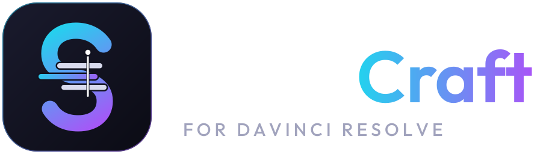

<p align="center"></p>

<p align="center"><b>Turn an unscripted interview into a story, inside DaVinci Resolve.</b><br>
More information, and the workflow in pictures: <a href="https://boris-edu.github.io/StoryCraft/"><b>boris-edu.github.io/StoryCraft</b></a></p>

> [!NOTE]
> StoryCraft is a fork of [BadWords](https://github.com/veritus-git/BadWords) by Szymon Wolarz. It is not affiliated with the original project. BadWords' own documentation lives [in its repository](https://github.com/veritus-git/BadWords#readme).

## Why StoryCraft

I edit video for fun, and what I love most is interviewing people with nothing prepared: no script, no questions sent ahead, just a conversation. The hard part comes afterwards: going through the footage, finding the moments that matter and building them into a story. It's fun, but it takes a lot of time, and that's where AI can help.

I looked for a tool that did exactly that and couldn't find one. BadWords came closest: it turns your footage into editable text inside DaVinci Resolve. StoryCraft is my version of it, built around one flow: **Clean up → Compose → Send to Resolve**.

## What StoryCraft adds

**Cleaner cuts, automatically**
- **Repeats:** words said twice ("I think I think"), self-corrections (the speaker starts a phrase, stops and starts again) and sentences that only echo the one before are cut; the final, fuller version stays. Lone "Yeah." / "Mhm." answers go too.
- **Sounds without words:** each cough, knock or background voice is measured against the speaker's voice. One much louder than any word is cut wherever it is; **Listen to sounds** plays the others one by one, with **Keep it / Cut it**.
- **Pauses:** Keep / Mark / Cut, and how much to remove, applied live. Inside a story, gaps with no words (a voice in the background) are removed.
- **Cut points** land on the quietest moment, never inside a word, and a clip never stops one or two words before its sentence ends.
- **Avoid** marker for parts you don't want used, and **second speaker** detection that marks the interviewer.

**Build the story**
- **Story board:** the transcript as blocks you drag into any order, with a target length and a clarity score on each block (how clearly it was spoken and recorded).
- **Any chat AI:** *Copy for AI* gives the transcript grouped into moments, with editing rules. *Import AI edit* checks the answer (length, clips that start mid-thought, two clips making the same point, a name repeated in every clip, Avoid parts, hard-to-hear parts) and writes a fix request to paste back.
- **Claude, directly:** with the built-in MCP server, Claude reads the transcript, checks its own edit until it flows, puts it on the story board and, if you ask, sends it to Resolve ([setup below](#build-a-story-with-claude)).
- **Review cuts:** a cut-by-cut review (what is said either side, jumps, loudness changes) that the AI uses to improve the order and the cut points.

**Watch, then send**
- **Play edit:** watch the edit, cuts and all, inside StoryCraft before Resolve gets anything.
- **Send to Resolve:** a new timeline, "*name* StoryCraft Edit N", in a **StoryCraft** bin, with short audio crossfades on every cut, Yellow **Jump cut** markers where the picture jumps within the same shot, and Cocoa **Sound** markers on the sounds the edit keeps. Your source timeline is never changed.

**Transcription**
- Whisper on the Apple Silicon GPU, or **Resolve's own transcription** with speaker detection (DaVinci Resolve Studio 21.1+).
- Each timeline's transcript is saved and reopens without transcribing again. Transcripts and stories are kept in your own StoryCraft folder (on a Mac: `~/Library/Application Support/StoryCraft`).

**Yours alone**
- No telemetry, no report form, no account: StoryCraft sends nothing anywhere. Updates are checked against this repository's releases only.
- Its own name, look and installer, so it sits next to an installed BadWords without touching it.

Every change, with its status, is listed in [FORK.md](FORK.md).

## Install

Paste the command for your system into a terminal. It downloads StoryCraft's installer from this repository; the installer puts StoryCraft in its own folder, adds `StoryCraft.app` (macOS) and the Resolve menu entry **Workspace → Scripts → StoryCraft**. Run the same command again later to update, repair or uninstall (uninstalling keeps your saved transcripts and stories).

**macOS**
```bash
curl -fsSL "https://raw.githubusercontent.com/Boris-Edu/StoryCraft/fork/setupfiles/mac-setup.sh" | bash
```

**Windows (PowerShell)**
```powershell
irm "https://raw.githubusercontent.com/Boris-Edu/StoryCraft/fork/setupfiles/windows-setup.ps1" | iex
```

**Linux**
```bash
curl -fsSL "https://raw.githubusercontent.com/Boris-Edu/StoryCraft/fork/setupfiles/linux-setup.sh" | bash
```

The scripts are plain text in [setupfiles/](setupfiles): read them before running them. StoryCraft is developed and tested on macOS with Apple Silicon and DaVinci Resolve Studio; Windows and Linux use the same installer but are untested.

**Requirements**
- DaVinci Resolve or DaVinci Resolve Studio (not the App Store version). Resolve's own transcription needs Studio 21.1+.
- About 4 GB of disk space, plus 1–5 GB for the speech models. On macOS and Linux, models an installed BadWords already downloaded are reused.
- In Resolve: *Preferences → System → General → External scripting using: Local* to launch StoryCraft from the desktop. For the details by Resolve version (Free or Studio, bridge mode), see the [original documentation](https://github.com/veritus-git/BadWords#readme): StoryCraft connects the same way.

## Build a story with Claude

StoryCraft includes an MCP server, so Claude Desktop or Claude Code can work with the open StoryCraft window. Claude reads the transcript in moments, checks its own edit until it flows and puts it on the story board; on request it sends it to Resolve as a new timeline. Your Claude app asks you to approve each step.

Setup (StoryCraft open on the timeline; replace `<install>` with StoryCraft's install folder):

- **Claude Code:** `claude mcp add storycraft -s user -- "<install>/venv/bin/python3" "<install>/mcp_server/storycraft_mcp.py"`
- **Claude Desktop:** in Settings → Developer → Edit Config, add to `mcpServers`:
  ```json
  "storycraft": {"command": "<install>/venv/bin/python3", "args": ["<install>/mcp_server/storycraft_mcp.py"]}
  ```

Then ask, for example: "Build a 2-minute story from this interview", and afterwards "Review the cuts". The connection only accepts requests from your own computer, with a key that changes every time StoryCraft starts. DaVinci Resolve Studio 21.1's own MCP server (File → Setup AI Assistants) can be connected at the same time.

## If you want to help the original developer

StoryCraft exists because **Szymon Wolarz** built [BadWords](https://github.com/veritus-git/BadWords) as a solo developer and shared it under the MIT licence: the transcription, the Resolve connection, the timeline assembly and the installer all started there. If StoryCraft saves you time, please support him directly:

<a href="https://www.buymeacoffee.com/BadWords" target="_blank"></a>

You can also star [the original repository](https://github.com/veritus-git/BadWords), and report problems that also happen in BadWords there.

## Contribute

Issues and pull requests are welcome on [this repository](https://github.com/Boris-Edu/StoryCraft/issues). More about StoryCraft: [boris-edu.github.io/StoryCraft](https://boris-edu.github.io/StoryCraft/). Brand guide: [BRAND.md](BRAND.md).

[Licence (MIT)](LICENSE) · Not affiliated with Blackmagic Design.
